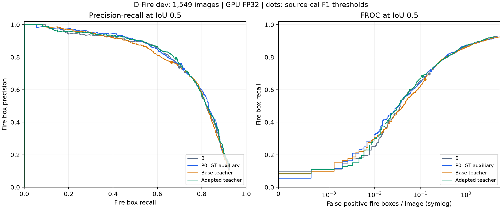

# 四组学生完整结果、早停与下一步决策

2026-11-10北京时间。**本轮已完成，推荐保留P0和适配教师作为两种有不同取舍的候选，只做一对独立种子复核；停止扩大基础教师配方及α/温度扫描。** 不把教师内部准确率当成学生收益，不把局部退化当作整个研究失败，也不以训练轮数多少判断好坏。

## 实际闭环

适配教师学生10:27:51保存退出，实际72轮，停止原因validation_plateau。第53/54/56/62轮的实质改善使训练继续；第61/68/69/70轮的小幅刷新仅更新最佳，不延长耐心。最佳第70轮训练期原GT火AP50:95为0.4164865764。最后一次实质改善参考为第62轮0.4156349996，至第72轮满足连续10轮/0.001的停止规则，没有补满100轮。

10:27:51完整dev/cal评价自动接续，10:29:01完成；四组汇总同秒完成，队列status=completed，各阶段returncode=0。CPU完整分析与2000次配对重采样随后完成，无新程序失败。最佳权重仅云端，SHA256为9f9f5c928a85c4003a4ef8f04879608d008e13b0e57e5b3d24dd158d9f592d2c。

此前第28轮中断、27轮检查点、原CSV/日志与恢复检查全部保留。恢复核验确认模型参数、采样轮次和AMP；不声称随机增广逐位重放。T_base原回执的66轮计数问题沿用既有审计：实际65轮，原件不改写。队列根字段completed_epochs=65指等待的T_base基线；适配学生阶段字段及CSV为72。旧latest-progress.json是08:35历史快照，最终状态以本目录最终queue-status.json/adapted-resume.json为准。

## 完整统一评价

同一D-Fire dev1549/cal1550、GPU FP32/batch4、保留原几何的COCO AP协议。训练期选模AP与以下统一推理AP分列。除AP/尺寸指标外，工作点指标使用各自源cal相同F1规则选择的阈值；它们不是相同数值阈值。test未参与本轮分析/选模。

| 指标 | B无辅助头 | P0无教师联合辅助 | T_base基础教师 | T_adapted适配教师 |
|---|---:|---:|---:|---:|
| 实际训练轮数 | 100 | 71 | 65 | 72 |
| 最佳轮次 | 60 | 60 | 55 | 70 |
| 火AP50:95 | 0.409638 | 0.412476 | 0.412323 | 0.413226 |
| 火AP50 | 0.753804 | 0.761759 | 0.749945 | 0.760313 |
| 烟AP50:95 | 0.549851 | 0.549688 | 0.548997 | 0.540923 |
| 双类AP50:95 | 0.479744 | 0.481082 | 0.480660 | 0.477075 |
| small640火AP50:95 | 0.296304 | 0.293857 | 0.294171 | 0.294921 |
| 火精确率 | 74.00% | 72.82% | 76.90% | 79.43% |
| 火召回率 | 69.84% | 71.78% | 66.36% | 68.30% |
| 火F1 | 0.718569 | 0.722966 | 0.712404 | 0.734469 |
| 火TP/FP/FN | 683/240/295 | 702/262/276 | 649/195/329 | 668/173/310 |
| 纯火框TP/143 | 104/143 | 108/143 | 106/143 | 103/143 |
| 原无火图触发/1141 | 16/1141 | 16/1141 | 15/1141 | 12/1141 |
| 仅烟图触发/435 | 14/435 | 14/435 | 14/435 | 10/435 |
| 空背景触发/706 | 2/706 | 2/706 | 1/706 | 2/706 |
| 纯火图火AP50:95 | 0.485232 | 0.492195 | 0.491748 | 0.486194 |
| 共存图火AP50:95 | 0.401216 | 0.402671 | 0.403292 | 0.405445 |
| CSV训练时间（小时） | 4.217 | 3.099 | 2.796 | 3.111 |

CSV时间为完整训练轮的分段elapsed之和，适配学生跨中断累计；不含未保存的第28轮部分、全部准备/收尾及所有计费时间。轮数减少不等于吞吐或方法质量更高。两套离线缓存另耗6419.72/6747.60秒，LoRA成本见前阶段完整记录；缓存可跨seed复用。四组部署参数均9949412，辅助头已移除，部署不运行Qwen；现有预测耗时含IO且未排除warmup，不声称完成了严格部署延迟基准。

## 公平看待误报—召回

适配教师相对P0：火AP增加0.0750个百分点，F1增加1.1503个百分点，精确率增加6.6077个百分点；误检框262→173、负图触发16→12。同时火召回下降3.4765个百分点、纯火TP108→103、烟AP下降0.8764个百分点，双类AP也下降。不能只报误检减少，也不能因此抹掉其火AP、精确率和仅烟误报的正向结果。

触发减少主要来自仅烟图14→10，空背景图仍为2/706。静态原标注负图触发不是现场每小时报警率。按统一dev曲线的固定召回网格比较如下；这是描述性曲线分析，不用这些dev阈值替换源cal阈值，不只选有利区间：

| dev召回目标 | B：FP/负图触发 | P0：FP/负图触发 | T_base：FP/负图触发 | T_adapted：FP/负图触发 |
|---|---:|---:|---:|---:|
| 0.5 | 58/8 | 52/6 | 66/7 | 50/5 |
| 0.6 | 97/11 | 103/10 | 136/12 | 90/8 |
| 0.7 | 241/16 | 214/15 | 235/16 | 219/13 |
| 0.75 | 346/24 | 343/22 | 346/21 | 341/19 |
| 0.8 | 628/28 | 525/28 | 554/23 | 599/27 |

在约70%召回时，适配教师相对P0负图触发15→13，但总FP214→219；75%召回时FP343→341、负图触发22→19；80%召回时FP525→599、负图触发28→27。适配教师具有部分低误报优势，但不是整条曲线均占优。

图中圆点为各模型源cal F1工作点；完整曲线覆盖全部已保存预测。SVG同目录保留以供导出。

## 描述性不确定性

2000次同图配对bootstrap、seed20261110，逐图TP/FP/GT/负图触发先与原评价总数核对一致。适配教师减P0的F1差为+0.01150，95%百分位区间[-0.00564,0.02949]；适配教师减基础教师为+0.02207，区间[0.00393,0.04078]。P0减B的F1差为+0.00440，区间[-0.01442,0.02224]。完整五项指标、四种对照的区间保存在full-analysis.json。

这些是单次训练、源cal各自工作点下的dev图像重采样，不能替代跨seed波动；相邻帧相关性可能使区间偏窄，不作事件独立或最终test显著性结论。结果支持复核适配教师相对基础教师的收益，但还不能确定其相对P0的收益稳定。

## 教师分布诊断

两教师全fit14122图均完整。原标注四态MAP一致数基础9217、适配11594；纯火27/770→570/770，仅烟988/3836→3180/3836，共存3043/3058→2504/3058，空背景5159/6458→5340/6458。全fit包含适配训练图，不能作为独立教师准确率。

固定教师内部256图holdout的生产概率审计在前阶段已确认132→204、NLL3.41744→0.53701、Brier0.87952→0.31714。适配教师的语义收益真实存在；如何变成学生检测收益需要单独检验。

全fit教师正确GT状态的平均概率0.64924→0.74046；75%GT/25%教师混合后的平均GT质量0.91231→0.93511。适配教师把不同状态的软化程度重新分配：纯火混合GT质量0.76519→0.91221，共存0.99787→0.92540。它提供了分析学习取舍的线索，但不是已经证实的因果解释；学生共存火AP本轮反而提高，不能简单断言共存教师误差必然导致共存检测下降。

## 下一步：有限配对复核，及时止损

1. 首先只比较P0与T_adapted的seed29；两组从相同通用权重开始，复用现有完整监督/教师缓存，头/增广/损失/停止规则相同。配置已准备：configs/train_dfire_P_control_seed29_20261110.json、configs/train_dfire_T_adapted_seed29_20261110.json。尚未启动新长训练；不重新评分、不重复LoRA、不扩大基础教师组。
2. 新一轮仍按验证有效进展停止，没有固定完成轮数。首轮seed17与seed29分别报告完整dev/cal、主AP、纯火/仅烟/共存/背景、尺寸及固定召回曲线；不把两个种子的预测混成一个模型。若火焰/误报综合收益能复现并有应用意义，才将配置冻结，按总方案开展Home-fire、FASDD_CV独立训练与FASDD_UAV外评，保留三来源四部分，不缩减论文数据规模。
3. 若教师相对P0的收益仍只是微小随机波动、阈值移动，或纯火/烟的代价抵消了所需收益，结束本T配方的扩展，不扫描α/温度、加长训练或反复重做LoRA。保留便宜的P0作为对照；下一项方法假设改为已有适配教师的区域核验→全量正权重W，使已观察到的区域判别收益更直接作用于检测。仅在该新机制有明确依据后做有限首轮；必要时再加入RuleW/ShuffleW归因，不要求所有模块都成立。

复核目的是决定是否值得扩大投入，不把两次预设更新/固定轮数当作论文完成标准。正向收益优先、已有方法可融合、SCI二区竞争力目标与完整原数据要求保持；最终发表价值由充分实验和期刊要求判断。

## 方法参考与边界

[A Good Teacher Adapts Their Knowledge for Distillation，ICCV2025](https://openaccess.thecvf.com/content/ICCV2025/papers/Qian_A_Good_Teacher_Adapts_Their_Knowledge_for_Distillation_ICCV_2025_paper.pdf)讨论教师—学生输出分布不匹配及其适配。我们借鉴“教师更准确不自动等于更适合学生”的检查思路，不将其分类蒸馏结论直接当作Qwen—YOLO设置的已证实原因。

[Unbiased Region-Language Alignment for Open-Vocabulary Dense Prediction，ICCV2025](https://openaccess.thecvf.com/content/ICCV2025/papers/Li_Unbiased_Region-Language_Alignment_for_Open-Vocabulary_Dense_Prediction_ICCV_2025_paper.pdf)研究区域语义与前景/背景偏置，支持后续关注局部信息的设计动机。这里只核查公开摘要/首页并吸收原则，不声称复现DenseVLM，也不强行更换当前主框架。CVF HTML直开403记录保留于台账，公开检索可读摘要/首页；未下载PDF/权重。

## 证据与资源

export-manifest.json记录109个原文件及导出SHA/字节，已逐项核验；包含适配学生全部72轮曲线、完整原GT选模、完整预测与分组/PR/FROC、恢复和原中断记录、四组比较、完整CPU分析与图。B/P0和T_base的完整原预测分别在results/stopping-policy-20261109与results/student-transfer-recovery-20261110，不重复下载。

本机只接收小型结果和图片，无模型权重或新增依赖。GPU已释放（本轮结束核查0%、1MiB），共享服务器仍开机；未自动关机或自动开始下一对长训练。权重/adapter只在云端保留。下载、缓存、配置和导出体积见唯一下载与安装台账。
